# DualSense Gyro Steering & Racing Haptics Engine

The `dualsense-gyro` skill equips agents and users with a complete diagnostic, calibration, tuning, and deployment toolkit for PlayStation 5 DualSense and DualSense Edge controllers operating over USB HID.

--------------------------------------------------------------------------------

## 1. Core Architecture

The system connects directly to the DualSense hardware over 250 Hz USB HID (`VID 0x054C, PID 0x0CE6/0x0DF2`), bypassing standard Windows driver limitations.

```mermaid
flowchart LR
    subgraph Hardware["DualSense Controller (250 Hz USB HID)"]
        IMU["6-Axis Gyro & Accel"]
        Sensors["Adaptive Triggers & Touchpad"]
    end

    subgraph Filters["Filter & Kinematics Pipeline"]
        F1["Sagittal Gravity Projection"] --> F2["Casiez 1-Euro Adaptive Filter"]
        F2 --> F3["Inverse Mathematical Pre-Compensation"]
        F3 --> F4["Velocity-Derivative Lead Filter"]
    end

    subgraph Game["Shift 2 Unleashed / Racing Sim"]
        XInput["xinput1_3.dll Proxy"] --> Physics["MAD Physics Engine"]
        Physics --> Racks["1:1 Linear Steering Rack Parity"]
    end

    Hardware --> Filters
    Filters --> Game
```



### Key Technical Capabilities
- **Sagittal Gravity Projection**: Corrects for lap/reclined driving posture ($-15^\circ$ to $-75^\circ$ pitch) without false gravity drift.
- **Rate-Driven 1-Euro Filter**: Clamps resting hand tremor while dropping phase lag to $<2.5\text{ ms}$ on counter-steering slides.
- **Mathematical Pre-Compensation**: Inverts the game's internal $3.75\%$ deadzone and quadratic curve ($x^2$), providing true 1:1 linear steering rack response while keeping all game controller XMLs 100% stock default.
- **Transitional Auto-Ramp**: 200 ms $C^2$ smootherstep blend on loading screen exit to eliminate starting grid rack snap.
- **Dual X/A Handbrake**: Maps both physical PlayStation Cross and Square to Handbrake in race while maintaining standard menu navigation.
- **Touchpad Glance**: Trackpad swipe glances camera into apex, corners, or rearview mirror without locking analog stick deflection.

--------------------------------------------------------------------------------

## 2. Interactive Workshop & Diagnostics (`gyro_workshop.exe`)

The standalone diagnostic utility `gyro_workshop.exe` provides real-time telemetry, calibration wizards, and automated verification tools directly in the console.

### Operating Modes

#### A. Interactive Telemetry HUD (Default Mode)
Run directly from terminal:
```powershell
.\gyro_workshop.exe
```
**Live Console Display:**
- ASCII Dual Racks: `[PROXY LX]` vs `[Shift2-Tyres]` (real-time in-game front-wheel angle).
- Interactive Keybindings:
  - `[C]`, `PS Button`, or `Mute Button`: Re-center steering horizon.
  - `[H]`: Toggle between **1:1 Pre-Compensated** and **Stock Crushed** in-game physics models live.
  - `[1]` / `[!]`: Decrease / Increase `MaxAngle` (default $75^\circ$).
  - `[2]` / `[@]`: Decrease / Increase `Deadzone` (default $1.0^\circ$).
  - `[3]` / `[#]`: Decrease / Increase `Curve` (default 100).
  - `[4]` / `[$]`: Decrease / Increase 1-Euro `MinCutoff` (default 1.20 Hz).
  - `[5]` / `[%]`: Decrease / Increase 1-Euro `Beta` (default 0.040).
  - `[6]` / `[^]`: Decrease / Increase `Smoothing` (100 = 1:1 passthrough, 50 = progressive rack).
  - `[F]`: Fire test flick haptic pulse.
  - `[T]`: Fire test R2 vibration pulse (Mode 0x26 @ 40 Hz).
  - `[S]`: Save tuned settings to `shift2_dualsense.ini`.
  - `[Q]`: Quit and restore default lightbar.

#### B. Zero-Rate Gyro Bias Calibration
Samples 500 reports (default 2s) while the controller rests flat, measures gyroscope bias $(\bar{\omega}_x, \bar{\omega}_y, \bar{\omega}_z)$, and prompts to save into `shift2_dualsense.ini`:
```powershell
.\gyro_workshop.exe --calibrate 3
```

#### C. Deadzone & Linearity Characterization Wizard
Measures center rest stability, breakout angle, and full lock travel, rendering an ASCII transfer curve:
```powershell
.\gyro_workshop.exe --test-deadzone
```

#### D. Jitter & Noise Benchmark
Measures resting standard deviation noise ($\sigma$) and step latency across 1000 frames:
```powershell
.\gyro_workshop.exe --test-jitter
```

#### E. Scriptable Sample Output
Dumps $N$ telemetry samples to stdout for automated testing:
```powershell
.\gyro_workshop.exe --sample 5
```

--------------------------------------------------------------------------------

## 3. Configuration Reference (`shift2_dualsense.ini`)

All runtime options are configured via `shift2_dualsense.ini` located next to `xinput1_3.dll`.

### `[Motion]`
- `StartEnabled=1`: Enable motion steering on launch (Mute button toggles).
- `MaxAngle=75`: Controller tilt angle for full steering lock (degrees). Realistic $75^\circ$ provides granular subtlety without flinging.
- `Deadzone=1`: Center deadzone in degrees.
- `Curve=100`: Motion curve (100 = linear).
- `Smoothing=100`: Rack dampening (100 = direct 1:1 passthrough, 50 = progressive weighted rack).
- `OneEuroMinCutoff=120`: 1-Euro minimum cutoff frequency in hundredths of Hz (120 = 1.20 Hz).
- `OneEuroBeta=40`: 1-Euro speed coefficient in thousandths (40 = 0.040).

### `[Handling]`
- `SpoofWheel=1`: Spoof `XINPUT_DEVSUBTYPE_WHEEL` (0x02) in `XInputGetCapabilities`.
- `Enabled=1`: Activate mathematical inverse pre-compensation for Shift 2's gamepad model.
- `GameDeadzone=4`: Lifts initial input above Shift 2's built-in $3.75\%$ deadzone.
- `Curve=50`: Exact inverse power curve ($\sqrt{x}$) that linearizes Shift 2's quadratic squaring ($x^2$).
- `Lead=40`: Velocity-derivative pre-charge that pre-charges 500 ms rise damping.
- `LeadMs=35`: Look-back time window for velocity lead (ms).

### `[Controls]`
- `InRaceOnly=1`: Enable race haptics and trigger resistance only during driving (keeps menus soft).
- `TimeoutMs=4000`: Milliseconds of pedal/rumble inactivity before returning to menu mode.
- `L3Handbrake=1`: Left Stick click (L3) acts as Handbrake in race.
- `XHandbrake=1`: Both PlayStation Cross ('X' glyph / Xbox A) and Square (Xbox X) act as Handbrake in race.
- `PSButton=1`: PS button re-centers motion steering and sends Xbox Back (Reset Car in Shift 2).

### `[MenuHaptics]`
- `ButtonVibe=1`: Subtle micro-haptics on menu button presses.
- `ButtonPower=55`: Gentle micro-tap power (1–255).
- `TriggerMode=0`: Soft stock triggers in menus (eliminates heavy brake resistance in menus).

--------------------------------------------------------------------------------

## 4. Verification & Testing

The test harness [`xinput_proxy_pressure_test.cpp`](file:///c:/Users/Zachariah/Documents/antigravity/vibrant-darwin/xinput_proxy_pressure_test.cpp) verifies 139 deterministic checks across 9 suites:
1. `PINPOINT_BOOT_HORIZON_ZERO`: Boot with tilt, assert true horizon alignment and 1mm steering breakout.
2. `PINPOINT_CORNER_HOLD_STABILITY`: 3.0s sustained corner hold with vibration, assert no decay.
3. `PINPOINT_TOUCHPAD_GLANCE_DECOUPLING`: Swipe tests verifying Right Stick deflection without `XB_R3` freeze.
4. `PINPOINT_MENU_TRIGGER_RECOVERY`: Inactivity timeout and 15-count menu deadzone.
5. `PINPOINT_THROTTLE_VIBRATION_ROUTING`: 40 Hz R2 vibration synthesis.
6. `PINPOINT_ASYMMETRIC_RACK_DAMPENING`: Turn-in, unwinding, and counter-steer crossover rates.
7. `PINPOINT_X_A_HANDBRAKE_MAPPING`: Cross, Square, and L3 handbrake routing with race hold immunity.
8. `PINPOINT_WHEEL_SPOOFING_AND_ZERO_DAMPING`: Capabilities spoofing and 200 ms smootherstep loading exit ramp.
9. `PINPOINT_GAME_INVERSE_PRECOMPENSATION`: Linear parity ($<1.5\%$ error) against Shift 2 physics model.

Run all tests:
```powershell
.\xinput_proxy_pressure_test.exe
```

--------------------------------------------------------------------------------

## 5. Build & Deployment Automation

### Compile Binaries
To build the 32-bit `xinput1_3.dll`, `gyro_workshop.exe`, and `xinput_proxy_pressure_test.exe` with MinGW32 GCC:
```cmd
cmd /c "echo. | .\build.bat"
```

### Deploy with SHA256 Verification
To deploy and synchronize all binaries and configs with 100% cryptographic parity across Workspace, Desktop Staging, and Game Directory:
```powershell
.\verify_repo.ps1 -Deploy -UpdateDocHashes
```
